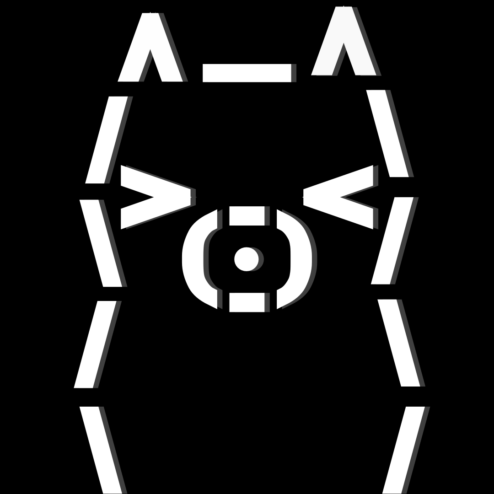
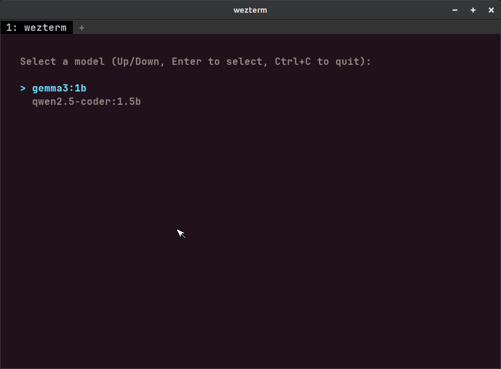
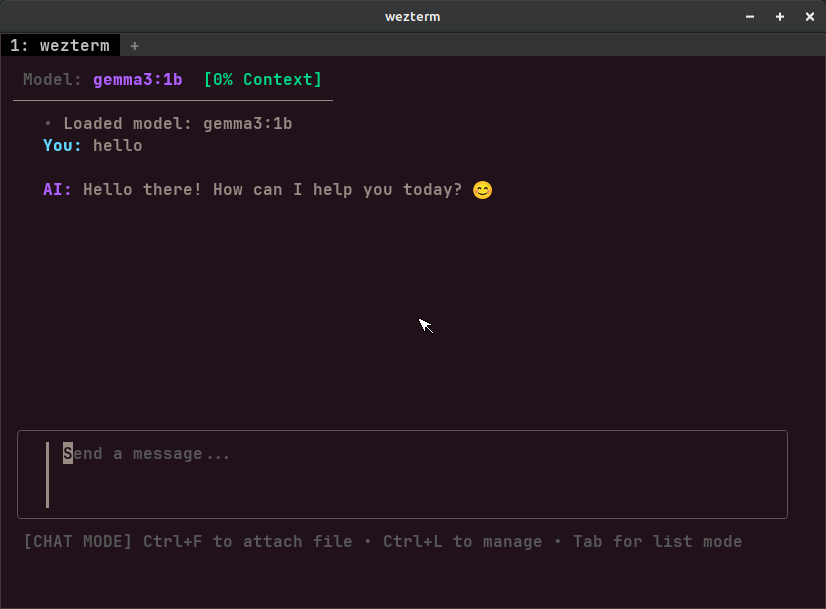
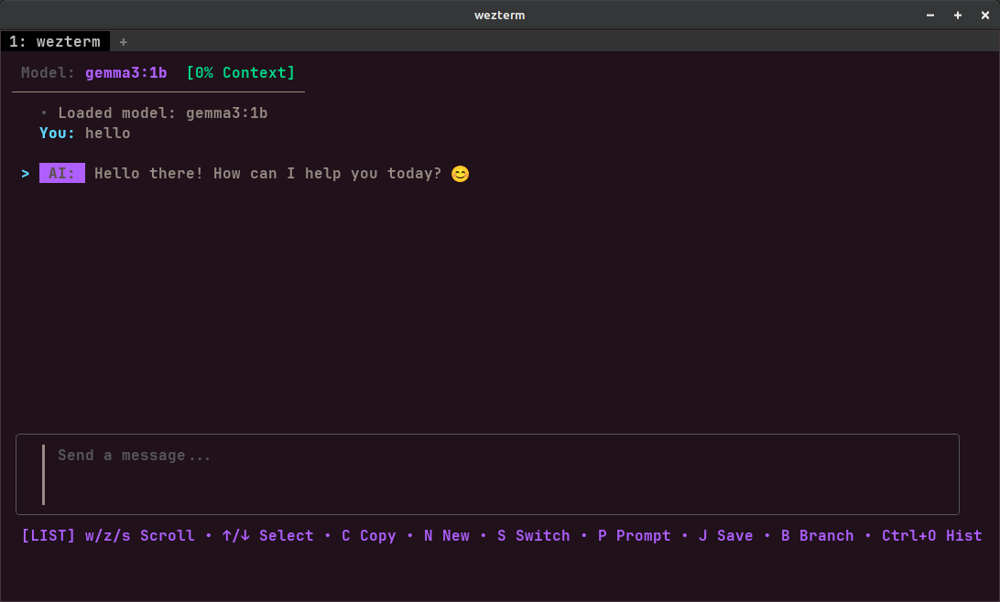
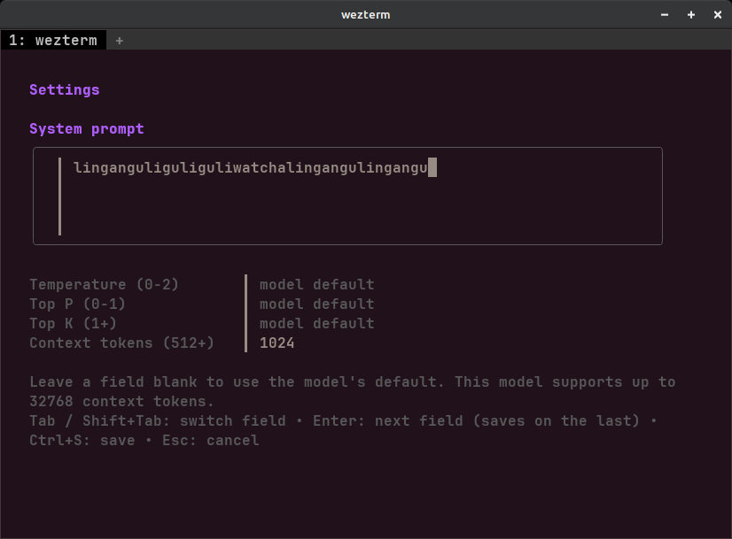

# Ollama-TUI 🦙💻

<p align="center">
  
</p>

<p align="center">
<i>The official logo of Ollama-TUI.</i>
</p>

<p align="center">
  <a href="https://github.com/AMC-official/Ollama-tui/releases"></a>
  <a href="LICENSE"></a>
</p>

Ollama-TUI is a fast, keyboard-first terminal client for [Ollama](https://ollama.com/) built entirely in Go. It also talks to **OpenRouter** and **OpenAI**, so one lightweight app covers your local models and the cloud ones. It focuses on responsiveness, native terminal rendering, and a workflow that feels at home in a shell rather than a browser.

Born out of a desire to ditch heavy Electron apps and web browsers, **Ollama-TUI** provides a sleek, Vim-friendly, fully native chat experience right inside your terminal. Built and tested primarily on Linux and FreeBSD for maximum speed and reliability.

> Note: AI assistants (DeepSeek and Claude) were used in the process of making this project to assist with development and iteration.

## 📸 Screenshots

### Startup

<p align="center">
  
</p>

<p align="center">
<i>Startup screen with model selection and automatic server management.</i>
</p>

---

### Chat Mode & List Mode

<table>
  <tr>
    <td align="center" width="50%">
      
      <br>
      <i>Chat Mode: native markdown rendering, streaming responses, context meter, and attachments.</i>
    </td>
    <td align="center" width="50%">
      
      <br>
      <i>List Mode: browse conversations, copy responses, branch chats, and navigate with Vim-style controls.</i>
    </td>
  </tr>
</table>

---

### Settings

<p align="center">
  
</p>

<p align="center">
<i>Configure the system prompt, temperature, top-P, top-K, and context token limit from one place.</i>
</p>

--------------------------------------------

## ✨ Features

### 🧠 Backends & models

* **Ollama, OpenRouter and OpenAI:** Cycle between them with `Ctrl+B` on the model screen. Your chat history carries over when you switch.
* **Cloud models:** Hundreds of models through OpenRouter (including free `:free` ones) and OpenAI's chat models, with live streaming, vision, tools and reasoning text.
* **API key screen:** Press `Ctrl+K` to add your keys (masked while you type). The `OPENROUTER_API_KEY` and `OPENAI_API_KEY` environment variables work too.
* **Model filter:** Press `/` on the model screen to filter long lists (try `:free` on OpenRouter).
* **Built-in Model Manager (local):** Pull new models from the Ollama library (`Ctrl+P`) with a size check, confirmation and a live progress bar showing speed and ETA. Delete models with confirmation (`Del`) or instantly (`Shift+D`).
* **Capability Detection:** Automatically detects if your model supports Vision, Thinking, or Tools, and shows it in the header.
* **Remote Ollama Support:** Connect to remote servers from the command line with the `--host` argument or from the model screen with `Ctrl+H`.
* **Auto-Server Management:** Automatically starts `ollama serve` in the background when needed, and offers to stop it when you exit (only if Ollama-TUI started it).

### 💬 Chatting

* **Native & Fast:** Built with [Bubble Tea](https://github.com/charmbracelet/bubbletea) and [Lipgloss](https://github.com/charmbracelet/lipgloss). No web wrappers, no Electron, just pure terminal speed.
* **Persistent Conversation Context:** The model remembers the whole conversation.
* **Markdown Rendering:** Replies, and your own messages, are rendered natively in the terminal (`**bold**`, `` `code` ``, lists, code blocks...).
* **Multi-line messages:** `Alt+Enter` or `Ctrl+J` adds a new line, `Enter` sends.
* **Cancelable Streams:** Stop the AI mid-generation with `Alt+S` if it starts yapping too much.
* **Generation Timer:** A live "waiting for the model" counter while a model loads, and the total time shown under every reply.
* **Thinking Viewer:** Press `Alt+T` to see the model's chain-of-thought (gray italic text) before the final response.
* **Branching:** Go back in time, pick a past message, and branch the conversation like ChatGPT.
* **Chat History:** Save your chats to `.json` files and load them back up anytime.
* **Vim-Style Navigation:** Use `Tab` to toggle between typing and "List Mode" to scroll and select messages.
* **Clipboard Integration:** Copy selected AI responses directly to your system clipboard.

### 🛠️ Tools

When the model supports tool calling (toggle with `Ctrl+Y`), the AI can use these tools. They all run locally on your machine and are read-only:

| Tool | What it does |
| --- | --- |
| `calculate` | Exact math (`+ - * / % ^`, parentheses, `pi`, `e`, `sqrt`, `abs`, `round`, `floor`, `ceil`), so small models stop guessing at arithmetic |
| `get_current_time` | Current date and time on your computer, optionally in another time zone |
| `list_files` | Lists files and folders, limited to the folder you started Ollama-TUI in |
| `read_file` | Reads a text file (first 20,000 characters), limited to the same folder |

File tools never show hidden files or folders (like `.env` or `.ssh`), refuse paths outside the start folder (also through symlinks), and reject binary files. Each answer may use up to 5 rounds of tool calls.

### 📎 Attachments

* **Text Attachment Support:** Attach files by entering their path, including text-based PDFs (not scanned images), `.txt`, `.docx`, `.odt`, and `.abw` documents and script files such as `.py` or `.sh`.
* **Vision Support:** Attach images (`.png`, `.jpg`, `.jpeg`, `.webp`) alongside text files.
* **Attachment Manager:** List, replace, delete, or edit attachments (`Ctrl+L`).
* **Image viewer:** Press `Shift+V` in the Attachment Manager or in List Mode (or use `:view` in the console) to look at a picture. Terminals that can draw images (**kitty, Ghostty, WezTerm, iTerm2**) show it right in the terminal until you press Enter. Everywhere else it opens in your system's default image viewer (`xdg-open`, `open`, `termux-open`, ...). See [Image viewer](#️-image-viewer).

### 🎛️ Customization

* **Settings Screen:** Configure the system prompt, temperature, top P, top K and context tokens in one place (`Shift+P` in List Mode). Blank fields use the model's own defaults.
* **Header with context bar:** Shows the model, the server, capability badges and how full the context window is (green, then yellow, then red). It shrinks to one line on small screens like phones.
* **Coloured messages:** `You` and `AI` labels in their own colours, with spacing between messages.

## 📦 Prerequisites

Before you build or run this, ensure you have:
1. **Go** (1.26+ is recommended) installed.
2. **Ollama** installed and available in your `$PATH` if you want to use local models. It's not needed if you only use OpenRouter or OpenAI.
3. **No model is required beforehand.** If none are installed, Ollama-TUI opens the built-in Model Manager so you can download one.

### 🐧 POSIX (FreeBSD, Linux, macOS) Dependencies

To copy text to the clipboard, the `atotto/clipboard` library requires `xclip`.

* **FreeBSD:** `sudo pkg install xclip`
* **Debian/Ubuntu:** `sudo apt install xclip`
* **RHEL/Fedora:** `sudo dnf install xclip`
* **Arch/Artix:** `sudo pacman -S xclip`
* **macOS:** No extra dependencies needed.

---

## 🚀 Installation

### 1. Clone & Build

```bash
git clone https://github.com/AMC-official/Ollama-tui.git
cd Ollama-tui
go mod tidy
```

### 2. Run the Installer

For POSIX (Linux, FreeBSD, macOS):

```bash
chmod +x install.sh
./install.sh
```

For Windows (PowerShell):

```powershell
.\install.ps1
```

### 3. Manual Run (Without Installing)

```bash
go run .
```

### 4. Build it by yourself

```bash
git clone https://github.com/AMC-official/Ollama-tui.git
cd Ollama-tui
go mod tidy
go build -o ollama-tui .
```

### 5. Download a ready-made binary

Prebuilt binaries for Linux, macOS, FreeBSD, OpenBSD, NetBSD and Windows are attached to every [release](https://github.com/AMC-official/Ollama-tui/releases).

---

## ☁️ Using OpenRouter or OpenAI

1. Create an API key at [openrouter.ai/keys](https://openrouter.ai/keys) or [platform.openai.com/api-keys](https://platform.openai.com/api-keys).
2. Start Ollama-TUI and, on the model screen, press `Ctrl+K`. Paste the key, then press `Ctrl+S`. (Or set `OPENROUTER_API_KEY` / `OPENAI_API_KEY` in your environment instead.)
3. Press `Ctrl+B` to switch to **OpenRouter** or **OpenAI**. The model list loads, and `/` filters it.
4. Pick a model with `Enter` and chat as usual.

> **Privacy:** With a cloud backend, your messages (and attached files and images) are sent to the provider you chose. Saved keys are stored as plain text in your config file (`~/.config/ollama-tui/config.json` on Linux), which only your user can read. Using the environment variables avoids storing a key at all.
>
> **Cost:** OpenAI and most OpenRouter models are paid. OpenRouter's `:free` models are free but rate limited. Ollama-TUI does not track spending.

## 🌐 Connecting to a Remote Ollama Server

You can run Ollama-TUI on one machine (like your phone or a laptop) and connect to an Ollama server running on another machine (like your main PC).

**On the server machine (the one running Ollama):**
You must expose Ollama to your local network. By default, Ollama only listens to `localhost`. Start it with:
```bash
OLLAMA_HOST=0.0.0.0 ollama serve
```
**On the client machine (the one running Ollama-TUI):**
Find the server's **local IP address** (e.g., 192.168.1.50), then run:
```bash
ollama-tui --host http://192.168.1.50:11434
```

> Alternatively, run `ollama-tui` and press `Ctrl+H` on the model selection screen to enter the address.
> If no local models are found on first launch, Ollama-TUI automatically opens the Model Manager so you can download one without leaving the application.

---

## ⌨️ Keybindings

Ollama-TUI uses a modal interface. You are either in Chat Mode (typing) or List Mode (navigating).

### Chat & List modes

| Key | Mode | Action |
| --- | --- | --- |
| Tab / Esc | Any | Toggle between Chat Mode and List Mode |
| Ctrl + F | Chat | Upload attachments by writing a path or drag-and-dropping files |
| Ctrl + L | Chat | List attached attachments and edit them |
| Enter | Chat | Send message to AI |
| Alt + Enter / Ctrl + J | Chat | Insert a new line in your message (Shift + Enter too, in terminals that report it) |
| Alt + S | Any | Cancel the AI mid-generation |
| Alt + T | Chat | Toggle the display of the model's thinking process |
| Ctrl + T | Any | Toggle Thinking mode (if supported by the model) |
| Ctrl + Y | Any | Toggle Tooling mode (if supported by the model) |
| w / z / s | List | Scroll up / down (Supports AZERTY & QWERTY) |
| Up / Down | List | Select a specific message |
| Shift + C | List | Copy the selected message to clipboard |
| Shift + N | List | Start a completely new chat |
| Shift + S | List | Switch to a different model |
| Shift + P | List | Open the Settings screen (system prompt, temperature, top P, top K, context) |
| Shift + J | List | Save current chat to `.json` |
| Shift + B | List | Branch the chat from the selected message |
| Ctrl + O | List | Open the Chat History browser |
| Shift + V | List, Attachment Manager | View the selected image (or the newest one of the chat) |
| Ctrl + C | Any | Exit app (offers to stop the Ollama server if Ollama-TUI started it) |
| Ctrl + G | Any | Open or close the console |
| : | List, Model selection | Open the console |
| Alt + H | Chat | Show or hide CPU / RAM / GPU percentages in the header |

### Model selection screen

| Key | Action |
| --- | --- |
| Up / Down (or k / j) | Move through the list |
| Enter | Select the model |
| Ctrl + B | Cycle the backend: Ollama, OpenRouter, OpenAI |
| Ctrl + K | Add or edit your API keys |
| Ctrl + R | Reload the model list (starts local Ollama first if it is not running) |
| / | Filter the list (Enter keeps the filter, Esc clears it) |
| Ctrl + H | Change the Ollama host URL (local Ollama only) |
| Ctrl + P | Pull a model from the Ollama library (local Ollama only) |
| Del (or d) | Delete the selected model, with confirmation (local Ollama only) |
| Shift + D | Delete the selected model immediately (local Ollama only) |

### Settings, API keys and Pull screens

| Key | Action |
| --- | --- |
| Tab / Shift + Tab | Switch field |
| Enter | Next field (saves on the last one) |
| Ctrl + S | Save (Settings and API keys) |
| Esc | Cancel or go back (during a download it cancels and keeps what was already downloaded) |

## 🧰 Console mode

For details about your models, token usage and your machine's load, open the console. Start it with:

```bash
ollama-tui --console
```

or press **`:`** on the model screen (or in List Mode) or **`Ctrl+G`** anywhere, including the Settings screen. `Esc` (or `Ctrl+G` again) closes it and takes you back to where you were.

Type a command and press Enter (the leading `:` is optional, `Up`/`Down` recall earlier commands, `PgUp`/`PgDn` scroll):

| Command | What it does |
| --- | --- |
| `:help` | List the commands |
| `:status` | Backend, server, model, abilities, context fill and chat size |
| `:chat <prompt>` | Ask the current model one question (separate from your chat). Shows what was sent, the reply **token by token** (yellow, green, yellow, green...), how many tokens went in and out, the speed in tokens per second, the time to the first token and the total time |
| `:chat` | Without a prompt: the **whole chat as the model receives it** (system prompt, every message, attached file text, tool calls and results), each message with its size in tokens and the text coloured token by token, plus the total and the biggest consumers |
| `:dump [full]` | Same as `:chat` without a prompt. Long messages are cut after 40 lines; `:dump full` shows everything |
| `:ctx` | Only the sizes: what fills the context window, message by message |
| `:colors [on\|off]` | Turn the yellow/green token colours on or off |
| `:tokens` | Token usage of this run (as reported by the server), speed of the last reply and the context window |
| `:top` | CPU, RAM, swap and GPU usage right now, with bars (CPU, RAM and swap on Linux and FreeBSD; GPU through `nvidia-smi` for NVIDIA or sysfs for AMD) |
| `:images` | List the pictures of this chat |
| `:view [n\|path]` | Show a picture: by number (see `:images`), by file path, or the newest one |
| `:copy` | Copy the last AI reply to the clipboard |
| `:export [name]` | Save the chat as a Markdown file in `~/.local/share/ollama-tui/exports/` |
| `:set [key value]` | Show or change `temp`, `top_p`, `top_k` or `ctx` (`default` clears one). Saved like the Settings screen, with the same limits |
| `:system [text]` | Show, set or clear (`:system clear`) the system prompt |
| `:models [text]` | List the models, optionally only those containing `text` |
| `:show [model]` | Details about a model: family, size, quantization, context length, capabilities |
| `:ps` | Models currently loaded in memory (Ollama) |
| `:unload [model]` | Free a model from memory (Ollama), all loaded models by default |
| `:switch <name>` | Switch to another model (a part of the name is enough) |
| `:start` | Start the local Ollama server |
| `:stop` | Stop the reply that is being generated |
| `:kill` | Stop the Ollama server, if Ollama-TUI started it |
| `:save [name]` | Save this console log as a `.json` file |
| `:logs` | Show where chats and console logs are saved, and the latest files |
| `:clear` | Clear the console |
| `:exit` | Close the console |

### 🎨 About the token colours

Every model has its own tokenizer and Ollama-TUI has none, so the colours come in two kinds:

* **The reply** of a `:chat <prompt>`: one streamed chunk is (almost always) one token, so these boundaries are real.
* **Text that was only sent** (system prompt, your messages, attached files): cut with a rough imitation of a BPE tokenizer. The sizes are estimates, close for English text. When the server reported a count for the last reply, `:chat` shows it next to the estimate.

Images are not counted: each one costs the model extra tokens. Saved console logs (`:save`) never contain colour codes.

### 🖼️ Image viewer

| Terminal | What happens |
| --- | --- |
| kitty, Ghostty | Drawn inline (kitty graphics protocol) |
| WezTerm, iTerm2, mintty | Drawn inline (iTerm2 image protocol) |
| anything else, tmux, screen | Opened in the default viewer: `xdg-open` / `gio open` (Linux, FreeBSD), `open` (macOS), `termux-open` (Termux), `wslview` (WSL), `start` (Windows) |

Pictures are shrunk to at most 1800 pixels before they are sent to the terminal. WebP is drawn inline by WezTerm and iTerm2; in kitty and Ghostty it opens in the default viewer unless you build with `go get golang.org/x/image/webp && go build -tags webp`. On FreeBSD install `xdg-utils` for the default viewer. Set `OLLAMA_TUI_IMAGE=kitty`, `iterm` or `off` to override the detection (for example over SSH, or inside tmux with passthrough enabled).

### 📊 Live load in the header

Press **`Alt+H`** in Chat Mode to show or hide the CPU, RAM, swap (only when it is in use) and GPU percentages in the header. They update every two seconds and turn yellow and red as the load grows. While they are hidden, nothing is read and no timer runs.

## 💾 Where things are stored

* **Settings and keys:** `config.json` in your user config folder (`~/.config/ollama-tui/` on Linux).
* **Saved chats:** `~/.local/share/ollama-tui/chats/` (chats saved by older versions are moved there automatically).
* **Saved console logs:** `~/.local/share/ollama-tui/console/`, as `.json` files with the log lines, the model and the token totals.

## 🧪 Development & Tests

```bash
go test -v .
```

The tests cover the parts that don't need a screen: the token splitter and the conversation dump, the image viewer's protocol detection and escape codes, message building, the calculator and file-tool safety checks, the OpenAI/OpenRouter stream parser, model list parsing and the formatting helpers. Please run them before opening a pull request.

## 🖥️ Platform Support

- Tested natively and working:
  - Linux
  - FreeBSD
  - Android (tested via Termux)
- Expected to work (untested):
  - macOS / Darwin
  - Windows
- Experimental / untested:
  - NetBSD
  - OpenBSD

> The project is primarily developed and validated on Linux and FreeBSD. Other Unix-like platforms and Windows are expected to be compatible, but native support is not yet officially confirmed.

## Known Limitations

- Tool calling depends on the selected model, and small models sometimes call tools badly.
- The context meter is an estimate (about 4 characters per token). For Ollama it uses your context setting (4096 by default), for cloud models the model's own limit.
- For OpenAI, vision, tools and reasoning support are guessed from the model name, because the API doesn't report them.
- On cloud backends the Thinking toggle only controls whether reasoning text is shown. OpenAI's reasoning models also reject a custom temperature, so leave that field empty for them.
- Custom OpenAI-compatible endpoints (like LM Studio or `llama-server`) can't be configured yet.
- Pulling, deleting and changing the host only work for local Ollama.
- Token colorizing is still a bit experimental so it might act up a bit (or a lot)

## 🛠️ Built With

* [Bubble Tea](https://github.com/charmbracelet/bubbletea) - The TUI framework.
* [Bubbles](https://github.com/charmbracelet/bubbles) - Text inputs and scrolling views.
* [Lipgloss](https://github.com/charmbracelet/lipgloss) - Style definitions for nice terminal layouts.
* [Glamour](https://github.com/charmbracelet/glamour) - Markdown rendering in the terminal.
* [Ollama API](https://github.com/ollama/ollama/blob/main/docs/api.md) - The local AI backend.
* [OpenRouter](https://openrouter.ai/docs) and [OpenAI](https://platform.openai.com/docs) APIs - The cloud backends.

> Note: In v1.1.3 and earlier, the `install.ps1` file may appear in non-Windows archives due to a `goreleaser.yml` misconfiguration. This is harmless and will be fixed in future releases. (whoops! sorry about that.)

## 📄 License

This project is licensed under the GNU General Public License v3.0 (GPL-3.0). See the [LICENSE](LICENSE) file for details.
